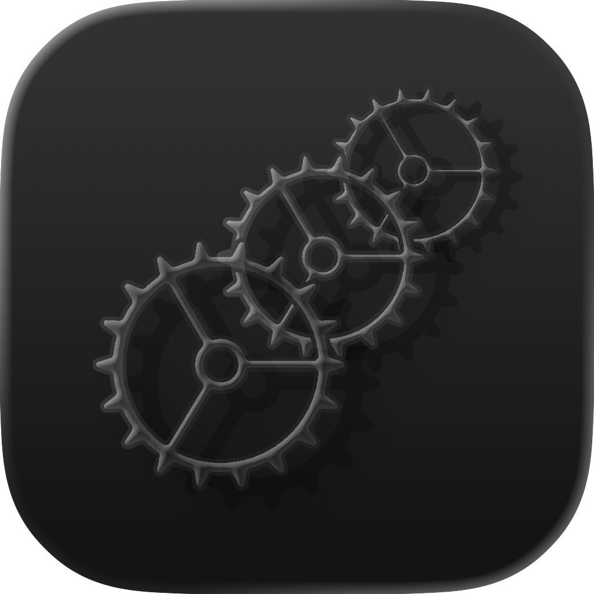
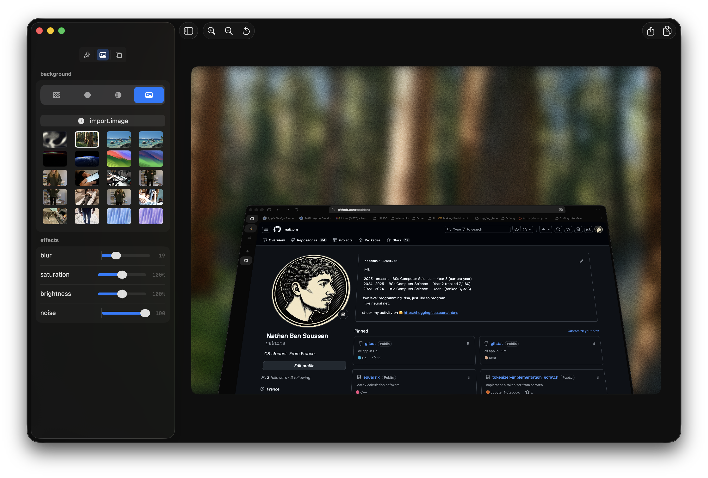
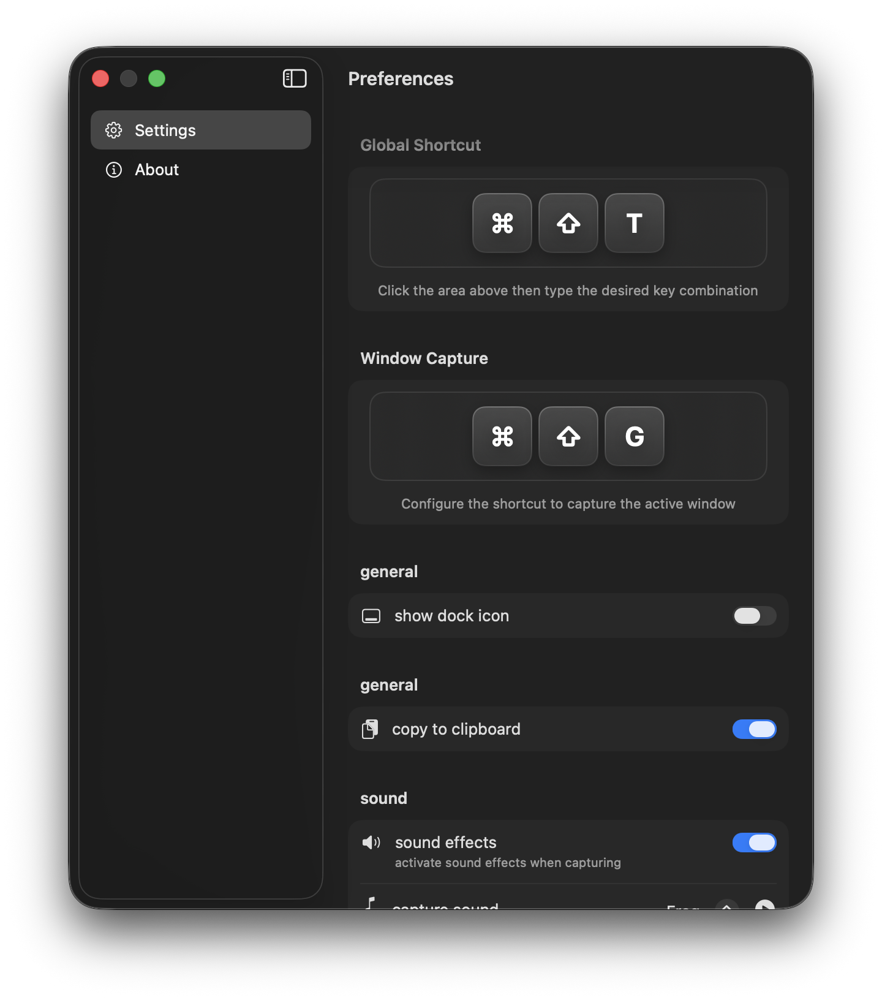
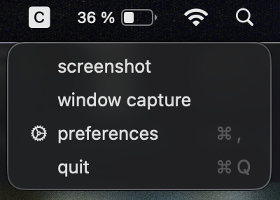

<p align="center">
  
</p>

# Clicke

A macOS menu bar application for capturing and styling screenshots.

## Features

- Screenshot capture with customizable keyboard shortcuts
- Styling options: frames, backgrounds (solid, gradient, mesh gradient, wallpapers)
- Social media export presets (Twitter, Instagram, LinkedIn, etc.)
- Privacy tools for blurring sensitive content
- Copy to clipboard or save as PNG

## Requirements

- macOS 14.0 or later
- Accessibility permissions for global hotkeys

## Installation

Download the latest `.dmg` :
- from the [clické.com](https://clické.com) website, then drag the app to your Applications folder.
- from the [Release](https://github.com/nathbns/clicke/releases/) page, then drag the app to your Applications folder.

The app is not notarized (no Apple Developer subscription). On first launch, macOS will block it. To open:

1. Try to open the app (it will be blocked)
2. Go to System Settings > Privacy & Security
3. Click "Open Anyway" next to the Clicke message

## Usage

### Capture

- Click the menu bar icon and select Screenshot
- Or use the default shortcut: Option + Shift + 4

### Editor



The editor provides tabs for styling, canvas background, and export options.

### Settings



### Menu Bar



### Keyboard Shortcuts

| Action | Default |
|--------|---------|
| Screenshot (area) | Option + Shift + 4 |
| Window capture | Option + Shift + T |
| Preferences | Command + , |

Shortcuts are customizable in Preferences.

## Building from Source

### Prerequisites

- Xcode 16.0 or later
- macOS 14.0 SDK

### Steps

```bash
git clone https://github.com/nathbns/clicke.git
cd clicke
open clicke.xcodeproj
```

Select your development team in Signing & Capabilities, then build with Command + R.

## Project Structure

```
clicke/
├── Coordinator/      App lifecycle, windows
├── Extensions/       Swift extensions
├── Features/
│   ├── Editor/       Screenshot canvas and renderer
│   └── Settings/     Preferences views
├── Managers/         Hotkey and toast managers
├── Models/           Data models
├── View/             Main views
└── ViewModel/        View models
```

## Contributing

See [CONTRIBUTING.md](CONTRIBUTING.md) for guidelines.

## License

MIT License. See [LICENSE](LICENSE) for details.
